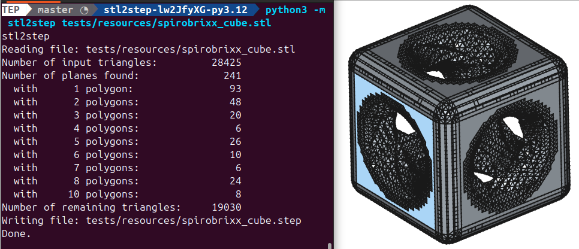

<!--
SPDX-FileCopyrightText: 2025 Stefan Helmert <stefan@entroserv.de>
SPDX-FileCopyrightText: 2025 stl2step contributors

SPDX-License-Identifier: AGPL-3.0-or-later
-->

# stl2step

*Intelligent STL → STEP conversion with a PyQt6 desktop GUI*

[](https://github.com/jfmiller52/stl2step/actions)
[](https://www.python.org/)
[](LICENSE)

[Features](#features) • [Getting started](#getting-started) • [CLI](#cli) • [GUI](#gui) • [Binary build](#binary-build) • [How it works](#how-it-works)

Converts triangle meshes into CAD-friendly STEP shells by clustering coplanar facets into real planes (with hole support), instead of dumping every triangle as a face. Smaller files, cleaner imports into CAD/CAM.



> [!IMPORTANT]
> Experimental: **planes** (including holes) are implemented. Cylinders, spheres, and other primitives are not yet.

## Features

- **Plane segmentation** — merges coplanar triangles into planar faces; leftover triangles stay as facets
- **Holes** — inner wires on plane faces are preserved through CadQuery / OCCT
- **CLI** — `python -m stl2step file.stl` writes `file.step`
- **Desktop GUI** — PyQt6 + PyVista preview (STL / STEP / Split), progress log, folder batch convert
- **Library API** — `convert_stl_to_step(..., on_log=, on_progress=)` for embedding
- **One-file binary** — optional PyInstaller build for the GUI

## Getting started

**Requirements:** Python **3.10–3.12** (3.11 recommended on Apple Silicon). CadQuery / OCP wheels are required.

### Install from source

```bash
git clone https://github.com/jfmiller52/stl2step.git
cd stl2step
python3.11 -m venv .venv
source .venv/bin/activate   # Windows: .venv\Scripts\activate
pip install -e .
```

With Poetry:

```bash
poetry env use python3.11
poetry install
```

> [!NOTE]
> PyPI still ships the original CLI package (`pip install stl2step`). For the GUI and current conversion API, use this repository checkout.

## CLI

```bash
python -m stl2step myfile.stl
# optional explicit output:
python -m stl2step myfile.stl out/myfile.step
```

By default the output path replaces the `.stl` suffix with `.step`.

```bash
# Poetry
poetry run stl2step myfile.stl

# tests (needs CadQuery)
pytest tests/
```

## GUI

Preview-dominant desktop app: large 3D viewport, file paths / Convert / progress / log on the right.

```bash
python -m stl2step.gui
# or
stl2step-gui
```

| Action | What it does |
|--------|----------------|
| **Open STL** | Loads the mesh into the viewer |
| **Convert** | Runs plane segmentation and writes STEP |
| **STL / STEP / Split** | Switch preview modes (STEP is tessellated for display) |
| **File → Convert folder…** | Batch-converts every `.stl` in a folder |

> [!TIP]
> Do not name a project folder or package `packaging` next to the repo root — it shadows PyPI’s `packaging` and breaks PyVista imports.

## Binary build

Bundle the GUI into a single executable (large: Qt + VTK + CadQuery):

```bash
pip install pyinstaller   # or: poetry install --with dev
pyinstaller stl2step-gui.spec --noconfirm --clean
# → dist/stl2step-gui
```

On macOS the first launch unpacks slowly. For unsigned builds:

```bash
xattr -d com.apple.quarantine dist/stl2step-gui
```

## How it works

```text
STL triangles
    → cluster coplanar faces (planes + holes)
    → keep unclassified triangles
    → CadQuery shell
    → STEP export
```

Core entry point: [`stl2step/convert.py`](stl2step/convert.py). GUI lives under [`stl2step/gui/`](stl2step/gui/). PyInstaller entry: [`pyinstaller_entry/run_gui.py`](pyinstaller_entry/run_gui.py).

Upstream idea and CLI originated with [TheTesla/stl2step](https://github.com/TheTesla/stl2step) by Stefan Helmert.
