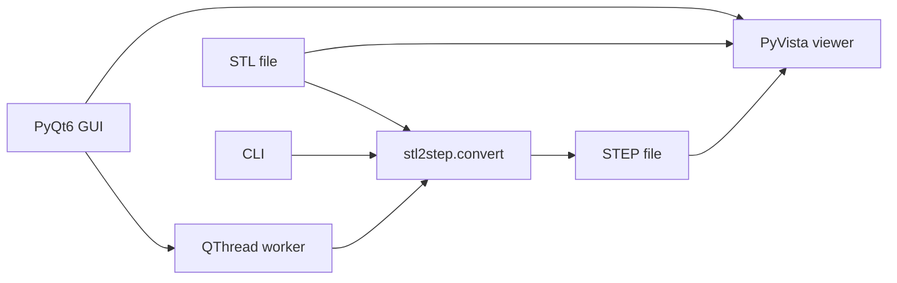

<!--
SPDX-FileCopyrightText: 2025 Stefan Helmert <stefan@entroserv.de>
SPDX-FileCopyrightText: 2025 stl2step contributors

SPDX-License-Identifier: AGPL-3.0-or-later
-->

<div align="center">

# stl2step

*Fork of TheTesla/stl2step — STL → STEP with a desktop GUI, library API, and one-file builds*

[](https://github.com/jfmiller52/stl2step/blob/main/LICENSE)
[](https://github.com/jfmiller52/stl2step/actions)
[](https://github.com/jfmiller52/stl2step/stargazers)
[](https://www.python.org/)

[Upstream](https://github.com/TheTesla/stl2step) · [This fork](https://github.com/jfmiller52/stl2step)

</div>

## What is this?

**stl2step** converts triangle meshes into CAD-friendly STEP by clustering coplanar facets into real planes (including holes), instead of exporting every triangle as a face. This fork keeps that conversion core and adds a PyQt6 + PyVista GUI, a callable library API, folder batch convert, and optional one-file packaging.

Original CLI and plane-segmentation work: [TheTesla/stl2step](https://github.com/TheTesla/stl2step) by Stefan Helmert.


> [!IMPORTANT]
> Experimental: **planes** (with holes) are implemented. Cylinders, spheres, and other primitives are not yet.

## Fork improvements

| Area | Upstream ([TheTesla/stl2step](https://github.com/TheTesla/stl2step)) | This fork |
|------|---------------------------------------------------------------------|-----------|
| Interface | CLI only (`python -m stl2step`) | CLI **plus** PyQt6 desktop GUI |
| Preview | None | STL / STEP / Split 3D views (PyVista) |
| Conversion API | Logic lived in `__main__.py` | Extracted [`stl2step/convert.py`](stl2step/convert.py) with `on_log` / `on_progress` |
| Batch | One file at a time | **File → Convert folder…** sequential batch |
| Packaging | Poetry library / CLI | Optional **one-file** GUI binary via PyInstaller |
| UX | Terminal output | Live progress bar + conversion log in the window |



## Quick Start

Requires **Python 3.10–3.12** (3.11 recommended on Apple Silicon). CadQuery / OCP wheels are required.

```bash
git clone https://github.com/jfmiller52/stl2step.git
cd stl2step
python3.11 -m venv .venv
source .venv/bin/activate          # Windows: .venv\Scripts\activate
pip install -e .

# CLI
python -m stl2step path/to/model.stl

# GUI
python -m stl2step.gui
```

With Poetry:

```bash
poetry env use python3.11
poetry install
poetry run stl2step model.stl
poetry run stl2step-gui
```

> [!TIP]
> Do not put a local package named `packaging` next to the project root — it shadows PyPI’s `packaging` and breaks PyVista.

## Usage

### CLI

```bash
python -m stl2step myfile.stl
python -m stl2step myfile.stl out/myfile.step
```

Default output replaces `.stl` with `.step`.

### GUI

| Action | Behavior |
|--------|----------|
| Open STL | Loads the mesh in the viewer |
| Convert | Plane segmentation → write STEP → refresh preview |
| STL / STEP / Split | Switch view modes (STEP is tessellated for display) |
| File → Convert folder… | Convert every `.stl` in a folder into a chosen output dir |

### Library

```python
from stl2step.convert import convert_stl_to_step

stats = convert_stl_to_step(
    "part.stl",
    "part.step",
    on_log=print,
    on_progress=lambda cur, total: print(f"{cur}/{total}"),
)
print(stats.planes, stats.output_path)
```

### One-file GUI binary

```bash
pip install pyinstaller   # or: poetry install --with dev
pyinstaller stl2step-gui.spec --noconfirm --clean
# → dist/stl2step-gui
```

First launch unpacks slowly. On macOS, unsigned builds may need:

```bash
xattr -d com.apple.quarantine dist/stl2step-gui
```

## Project Structure

```
stl2step/
├── .github/
│   └── workflows/
├── LICENSES/
├── pyinstaller_entry/
│   ├── __init__.py
│   └── run_gui.py
├── stl2step/
│   ├── gui/
│   │   ├── __init__.py
│   │   ├── __main__.py
│   │   ├── main_window.py
│   │   ├── viewer.py
│   │   └── worker.py
│   ├── __init__.py
│   ├── __main__.py
│   ├── _version.py
│   └── convert.py
├── tests/
│   └── resources/
├── LICENSE
├── Makefile
├── README.md
├── REUSE.toml
├── example_step.png
├── poetry.lock
├── pyproject.toml
└── stl2step-gui.spec
```

## Documentation

| Resource | Description |
|----------|-------------|
| [`stl2step/convert.py`](stl2step/convert.py) | Conversion API and plane-segmentation pipeline |
| [`stl2step/gui/`](stl2step/gui/) | PyQt6 main window, viewer, background workers |
| [`stl2step-gui.spec`](stl2step-gui.spec) | PyInstaller one-file GUI build |
| [`tests/test_simple.py`](tests/test_simple.py) | CLI smoke tests against sample STLs |
| [Upstream README](https://github.com/TheTesla/stl2step) | Original project notes and experimental scope |

## Contributing

Issues and PRs on this fork are welcome. Please keep new files AGPL-3.0-or-later compatible and avoid adding a top-level `packaging/` directory.

Upstream conversion credit belongs to Stefan Helmert — please cite [TheTesla/stl2step](https://github.com/TheTesla/stl2step) when discussing the algorithm.

<a href="https://github.com/jfmiller52/stl2step/graphs/contributors">
  
</a>

## License

AGPL-3.0-or-later — see [LICENSE](LICENSE). Same license family as upstream.

---

<div align="center">

[](https://star-history.com/#jfmiller52/stl2step&Date)

</div>
